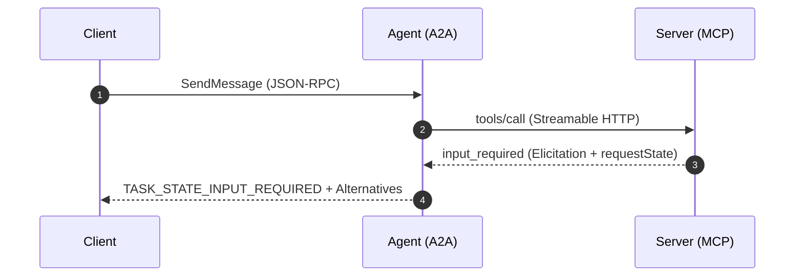
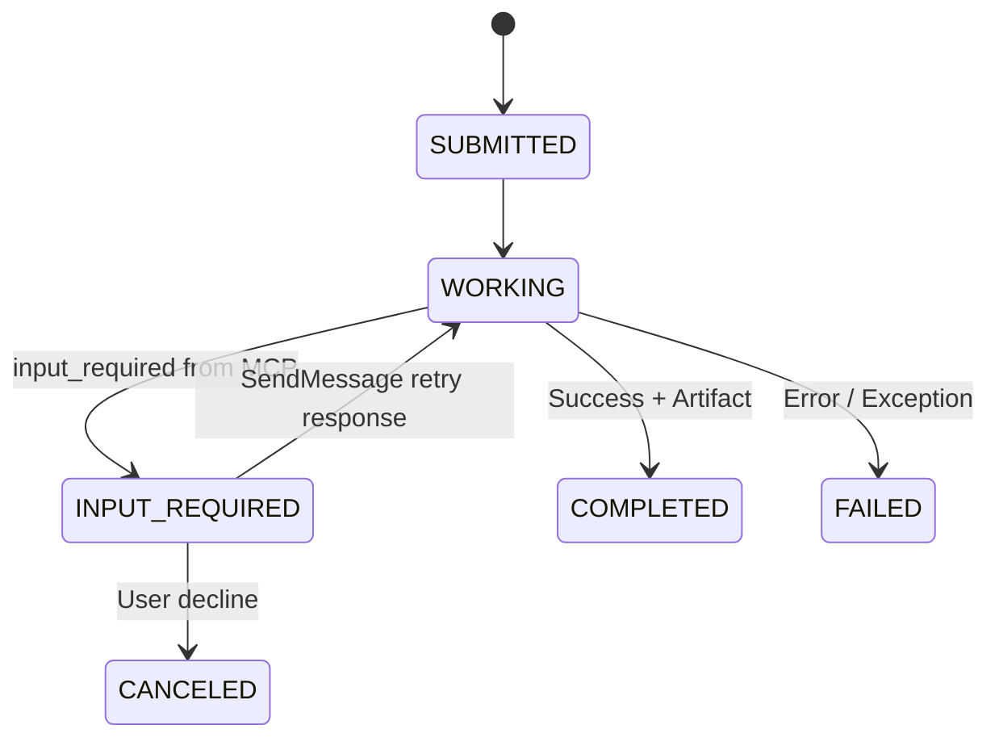

# Technical Specification (SPEC) Authoring

A Technical Specification (SPEC) details the low-level technical design, data contracts, API protocols, sequence diagrams, and error codes required to implement a PRD or architectural decision.

---

## When to Use

Activate this skill when:
- Designing API schemas (REST, JSON-RPC, MCP, A2A).
- Specifying exact request/response wire formats and error codes.
- Defining state machines, data structures, and protocol boundaries.
- Documenting error propagation rules and header context (e.g., `traceparent`).

---

## Technical SPEC Structure & Template

Save SPEC documents in `docs/spec/SPEC-feature-name.md`.

```markdown
# Technical Specification: [System / Protocol / Feature Name]

- **Status**: Draft | In Review | Approved | Implemented
- **Related PRD**: [Link to PRD]
- **Related ADRs**: [Link to ADRs]
- **Version**: 1.0.0

---

## 1. System Architecture & Components

High-level architecture diagram and component interaction overview.



## 2. API & Data Contracts

### 2.1 Endpoint Specification

- **Protocol / Transport**: JSON-RPC 2.0 over Streamable HTTP
- **URL Path**: `/a2a` or `/mcp`
- **Headers**:
  - `Content-Type: application/json`
  - `MCP-Protocol-Version: 2026-07-28`
  - `traceparent: 00-<trace_id>-<span_id>-01`

### 2.2 Wire Formats & Schemas

#### Request Payload
```json
{
  "jsonrpc": "2.0",
  "id": 1,
  "method": "tools/call",
  "params": {
    "name": "reservar_sala",
    "arguments": {
      "sala": "sala-garagem",
      "inicio": "2026-11-03T14:00:00-03:00",
      "fim": "2026-11-03T15:00:00-03:00",
      "responsavel": "Marty"
    },
    "_meta": {
      "io.modelcontextprotocol/protocolVersion": "2026-07-28",
      "io.modelcontextprotocol/clientCapabilities": { "elicitation": { "form": {} } }
    }
  }
}
```

#### Response Payload (Input Required)
```json
{
  "jsonrpc": "2.0",
  "id": 1,
  "result": {
    "resultType": "input_required",
    "inputRequests": {
      "req-1": {
        "method": "elicitation/create",
        "params": {
          "mode": "form",
          "message": "A sala pedida esta ocupada nesse intervalo. Escolha uma alternativa.",
          "requestedSchema": {
            "type": "object",
            "properties": {
              "sala": { "type": "string", "enum": ["sala-fusca", "sala-mirante"] }
            },
            "required": ["sala"]
          }
        }
      }
    },
    "requestState": "<opaque-hmac-token>"
  }
}
```

## 3. State Machine & Lifecycle Transitions

State transitions for asynchronous or multi-step operations:



## 4. Error Codes & Exception Mapping

| Condition | Protocol Error Code | HTTP Status | Response Payload / Message |
|---|---|---|---|
| Invalid Schema / Missing Meta | `-32602` | 400 | Invalid Params |
| Missing Elicitation Capability | `-32021` | 400 | `data.requiredCapabilities` |
| Invalid / Expired `requestState` | `-32602` | 400 | Verification failed |
| Tool Error (Room not found) | `isError: true` | 200 | `Sala inexistente: <id>` |

## 5. Security & Integrity Specifications

- State token signing algorithm: HMAC-SHA256.
- Secret source: `REQUEST_STATE_SECRET` environment variable (min 32 bytes entropy).
- Expiration window: 15 minutes.
```

---

## Best Practices

1. **Exact Error Code Mapping**: Leave zero ambiguity regarding HTTP status vs JSON-RPC protocol error vs tool execution error.
2. **Deterministic Schemas**: Document explicit JSON schemas for inputs, outputs, and metadata.
3. **Traceability**: Link every technical requirement back to its corresponding PRD item.
