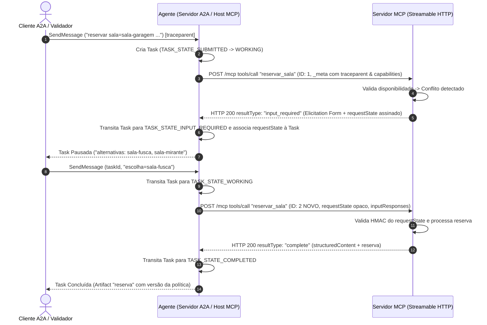

# ADR-001: Arquitetura de Integração A2A com Servidor MCP e Ciclo MRTR

- **Status**: Accepted
- **Date**: 2026-10-04
- **Authors**: Antigravity / Equipe de Arquitetura de Sistemas
- **Deciders**: Equipe de Engenharia Hill Valley Tech
- **Technical Story**: Desafio A2A com MCP - A Ponte (`docs/desafio.md`)

---

## 1. Contexto e Declaração do Problema

A Hill Valley Tech necessita de uma solução automatizada para reserva de salas de reunião, expondo essa capacidade para assistentes e agentes corporativos sem intervenção manual em planilhas compartilhadas.

O desafio arquitetural central reside na integração de duas fronteiras de protocolo stateless:
1. **Fronteira Externa (A2A - Agent-to-Agent v1.0)**: O agente atua como servidor A2A sobre transporte HTTP (JSON-RPC 2.0), gerenciando o ciclo de vida de workflow por meio de `Tasks` (`TASK_STATE_SUBMITTED`, `WORKING`, `INPUT_REQUIRED`, `COMPLETED`, `CANCELED`, `FAILED`).
2. **Fronteira Interna (MCP - Model Context Protocol v2)**: O agente atua como host MCP, consumindo um servidor MCP via Streamable HTTP (`/mcp`) que expõe as ferramentas (`listar_salas`, `consultar_disponibilidade`, `reservar_sala`) e resources (`politica://uso`).

Como ambos os transportes HTTP são desprovidos de sessão e não possuem canal bidirecional síncrono de retorno (callbacks), quando o servidor MCP identifica um conflito de horários e necessita de mais informações (solicitando a escolha de salas alternativas via elicitation em *form mode*), a chamada não pode bloquear nem o servidor MCP pode chamar o agente de volta. 

Formula-se a necessidade de desenhar "A Ponte": um mecanismo resiliente de coordenação de estado que interrompa a `Task` no A2A, armazene o estado de requisição opaco (`requestState`), solicite a entrada do usuário cliente e retome a chamada MCP com um novo ID de requisição JSON-RPC.

---

## 2. Direcionadores da Decisão (Decision Drivers)

- **RF-01 (Statelessness e MRTR)**: Cumprimento estrito do padrão MRTR (*Most Recent Tool Result*) do MCP para solicitação de inputs sem manter estado de sessão em memória no servidor MCP.
- **RF-02 (Ciclo de Vida de Task A2A)**: Mapeamento transparente e determinístico da solicitação `input_required` do MCP para o estado `TASK_STATE_INPUT_REQUIRED` do A2A.
- **RF-03 (Segurança e Integridade de Estado)**: O `requestState` é uma entrada controlada por atacante e deve possuir garantia criptográfica de integridade (HMAC/AEAD) com expiração definida (5 a 30 minutos).
- **RF-04 (Rastreabilidade End-to-End)**: Propagação contínua do contexto de rastreamento (`traceparent`) desde a requisição A2A inicial até o servidor MCP e logs em `stderr`.
- **RF-05 (Determinismo e Opacidade)**: Execução baseada em regras sem dependência de LLMs no caminho crítico, garantindo contratos estritos e respostas reproduzíveis.

---

## 3. Alternativas Consideradas

### Opção 1: Conexão Síncrona Bloqueante / Polling Ativo (Rejeitada)
- **Descrição**: Manter a requisição HTTP em suspenso enquanto o agente aguarda a resposta do cliente A2A.
- **Prós**: Implementação trivial sem necessidade de gerenciamento de interrupção de `Task`.
- **Contras**: Viola a premissa dos transportes HTTP stateless; inviável em cenários de timeout HTTP; causa esgotamento de conexões/threads no servidor; não suporta restart dos processos.

### Opção 2: Persistência Centralizada de Sessão no Servidor MCP (Rejeitada)
- **Descrição**: O servidor MCP salva o estado do formulário/reserva em banco de dados interno ou cache Redis e retorna um identificador de sessão para o agente.
- **Prós**: Facilidade de recuperação de estado no lado do servidor.
- **Contras**: Viola a arquitetura stateless do MCP e a especificação MRTR; introduz dependência de infraestrutura externa (banco de dados/ORM), em desconformidade com o escopo do desafio.

### Opção 3: Ponte Reativa com Estado Opaco em MRTR (`requestState`) e Máquina de Estados de Task A2A (Aceita)
- **Descrição**: O servidor MCP emite uma resposta `input_required` contendo elicitation em *form mode* e um `requestState` assinado por HMAC contendo os dados selados da requisição original. O agente captura essa resposta, altera o estado da `Task` para `TASK_STATE_INPUT_REQUIRED` e armazena localmente a associação entre a `Task` e o `requestState`. Ao receber a resposta do cliente (`escolha=<id>`), o agente reenvia a tool `reservar_sala` com um **ID JSON-RPC novo**, incluindo o `requestState` intacto e os `inputResponses`.
- **Prós**:
  - Resiliência total: o servidor MCP pode ser reiniciado entre o `input_required` e o retry sem perda de contexto.
  - Conformidade estrita com as especificações MCP v2 (2026-07-28) e A2A v1.0.
  - O agente não precisa conhecer as regras de negócio de sala (manutenção da separação de responsabilidades).
  - Garantia de segurança e integridade no transporte de dados via HMAC (`REQUEST_STATE_SECRET`).
- **Contras**: Requer coordenação precisa dos IDs de requisição JSON-RPC e validação de capabilities (`io.modelcontextprotocol/clientCapabilities`).

---

## 4. Decisão e Arquitetura Resultante

**Opção Selecionada**: **Opção 3** - Ponte Reativa com Estado Opaco em MRTR e Ciclo de Vida de Task A2A.

### Componentes Chave da Solução:

1. **Proteção e Criptografia do `requestState`**:
   - Assinatura via HMAC-SHA256 utilizando a chave Secreta `REQUEST_STATE_SECRET` (mínimo de 32 bytes de aleatoriedade gerados via `secrets.token_hex(32)`).
   - Inclusão de timestamp de expiração (janela de 5 a 30 minutos).
   - Rejeição de estados adulterados ou expirados com código de erro JSON-RPC `-32602`.

2. **Negociação de Capabilities e Metadados**:
   - Todo request emitido pelo Agente inclui obrigatoriamente `_meta` com `io.modelcontextprotocol/protocolVersion` e `io.modelcontextprotocol/clientCapabilities` declarando `{"elicitation": {"form": {}}}`.
   - Requisições sem os campos de metadados obrigatórios são rejeitadas pelo Servidor MCP com `-32602` / HTTP 400.
   - Solicitação de elicitation direcionada a clientes sem a capability declarada é rejeitada com `-32021` / HTTP 400.

3. **Propagação de Contexto e Observabilidade**:
   - Header `traceparent` é propagado em todas as chamadas MCP dentro da mesma `Task`.
   - Log estruturado no `stderr` do Servidor MCP registrando método, ID da requisição e `traceparent`.

4. **Tratamento Semântico de Erros**:
   - **Erros de Negócio/Execução (`isError: true`)**: Sala inexistente, violação de janela de uso (08:00 - 20:00), duração superior a 2h, intervalo inválido ou ausência de alternativas. Resultam em `TASK_STATE_FAILED` no A2A.
   - **Erros de Protocolo (JSON-RPC `error`)**: Rejeição de ferramentas/recursos inexistentes, requisições malformadas ou violação de integridade.

---

## 5. Consequências e Trade-offs

### Consequências Positivas
- **Desacoplamento e Opacidade**: O cliente A2A interage estritamente com o protocolo A2A sem conhecimento da infraestrutura MCP subjacente.
- **Resiliência a Restarts**: Como o `requestState` contém todo o estado selado e assinado, a reinicialização do processo do Servidor MCP entre a elicitation e o retry não invalida a transação.
- **Segurança da Informação**: O `requestState` é inteiramente opaco para o agente e protegido contra adulteração por atacantes na borda.
- **Rastreabilidade**: O alinhamento de `traceparent` garante observabilidade contínua das requisições através dos limites de processo.

### Consequências Negativas / Trade-offs
- **Gerenciamento de Estado de Tasks no Agente**: Exige armazenamento em memória da associação entre `taskId` e `requestState` durante o período de solicitação de input.
- **Sobrecarga de Serialização**: Necessidade de serializar/deserializar e assinar os parâmetros da requisição original a cada ciclo de elicitation.

---

## 6. Validação e Conformidade

A conformidade desta decisão arquitetural é verificada de forma automatizada e determinística através da suíte de testes do repositório (`validador/validar.py`), englobando 36 verificações:

1. **Protocolo MCP HTTP (Verificações 1 a 20)**:
   - Validação de endpoints HTTP 7301, headers obrigatorios, `tools/list`, `resources/read` (`politica://uso`), erros de execução e erros de protocolo.
   - Validação de integridade do `requestState` (rejeição de adulteração com `-32602`).
   - Verificação de independência de restart do servidor MCP durante ciclos MRTR.

2. **Protocolo A2A e A Ponte (Verificações 21 a 36)**:
   - Validação de Agent Card (`/.well-known/agent-card.json`).
   - Fluxo de `SendMessage` / `GetTask` em cenários de sala livre, sala ocupada (pausa em `TASK_STATE_INPUT_REQUIRED`), recusa de alternativa e falhas por parâmetros inválidos.
   - Transição adequada de IDs de requisição JSON-RPC nas retomadas.

---

## 7. Referências

- **Especificação do Desafio**: [`docs/desafio.md`](file:///home/almir/projetos/desafio-a2a-com-mcp/docs/desafio.md)
- **MCP Spec (Revisão 2026-07-28)**: Model Context Protocol v2 (Streamable HTTP, MRTR Elicitation)
- **A2A Spec v1.0**: Agent-to-Agent Protocol Binding JSON-RPC 2.0
