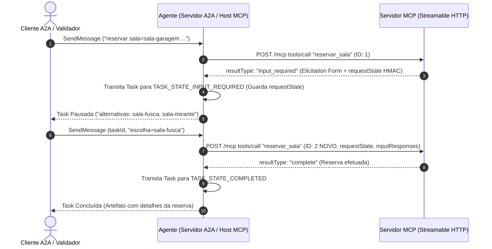

# PRD: Sistema de Reserva de Salas — A Ponte (Agente A2A com MCP)

- **Status**: Approved
- **Target Release / Milestone**: Versão 1.0.0 (Desafio Prático MBA Engenharia de Software com IA)
- **Owner**: Equipe de Arquitetura e Engenharia (Hill Valley Tech)
- **Document Version**: 1.0.0

---

## 1. Executive Summary & Business Goals

O projeto **"A Ponte: um agente A2A com MCP por dentro"** tem como objetivo automatizar e padronizar o processo de reserva e consulta de salas de reunião na empresa Hill Valley Tech, eliminando a dependência de planilhas manuais e descentralizadas.

A solução consiste em integrar duas especificações de protocolo *stateless*:
1. **Servidor A2A (Agent-to-Agent Protocol v1.0)** exposto na porta `7300` (binding JSON-RPC 2.0 sobre HTTP), permitindo a descoberta da capacidade `reservar-sala` via Agent Card e o gerenciamento do ciclo de vida de tarefas (`Tasks`).
2. **Servidor MCP (Model Context Protocol v2 - Revisão 2026-07-28)** exposto na porta `7301` (`/mcp` em Streamable HTTP), provendo ferramentas de domínio (`listar_salas`, `consultar_disponibilidade`, `reservar_sala`) e o recurso de política (`politica://uso`).

O objetivo de negócio principal é fornecer um mecanismo determinístico de mediação ("A Ponte") capaz de gerenciar conflitos de agendamento por meio do ciclo **MRTR** (*Most Recent Tool Result*), pausando requisições A2A no estado `TASK_STATE_INPUT_REQUIRED` e retomando a execução de forma segura, mantendo opacidade de estado e resiliência a reinicializações de processos.

---

## 2. Problem Statement & User Personas

### 2.1 Problem Statement
A Hill Valley Tech possui 5 salas de reunião gerenciadas informalmente por uma planilha compartilhada. Para permitir a reserva via assistentes virtuais e agentes autônomos da empresa, é necessário expor essas ferramentas em protocolo padrão.

Contudo, tanto o transporte HTTP do A2A quanto do MCP são totalmente *stateless* e sem callbacks síncronos:
- Quando ocorre conflito de horário na reserva de uma sala, o servidor MCP necessita interagir com o cliente para solicitar a escolha de uma alternativa.
- O agente A2A não pode travar a requisição em tempo de execução nem manter sessões abertas no servidor.
- É necessário realizar a costura de estado: o agente intercepta a necessidade de entrada (`input_required`), transita a `Task` A2A para `INPUT_REQUIRED`, armazena o `requestState` assinado e, ao receber a decisão do cliente, reenvia a requisição MCP com um novo ID JSON-RPC.

### 2.2 Target Users / Personas
- **Persona 1: Agente Cliente A2A (ou Cliente de Validação Automatizada)**  
  Agente consumidor externo que descobre as habilidades da Hill Valley Tech via Agent Card (`/.well-known/agent-card.json`), inicia tarefas de reserva via `SendMessage` e responde a solicitações de escolha quando a tarefa exige entrada adicional.
- **Persona 2: Host MCP Interno (Agente A2A)**  
  Componente interno do agente que inspeciona o catálogo de ferramentas MCP (`tools/list`), consome políticas (`resources/read`) e orquestra as chamadas de API MCP repassando metadados obrigatórios de protocolo e contexto de rastreamento (`traceparent`).

---

## 3. Scope & Out of Scope

### In Scope
- **Servidor A2A (Porta 7300)**:
  - Publicação de Agent Card em `GET /.well-known/agent-card.json` declarando a skill `reservar-sala`.
  - Endpoint JSON-RPC 2.0 em `POST /a2a` suportando `SendMessage` e `GetTask`.
  - Máquina de estados completa para `Task` (`SUBMITTED`, `WORKING`, `INPUT_REQUIRED`, `COMPLETED`, `CANCELED`, `FAILED`).
  - Suporte à interrupção e retoma via `TASK_STATE_INPUT_REQUIRED` e retenção do token opaco `requestState`.
- **Servidor MCP (Porta 7301)**:
  - Transporte Streamable HTTP em `/mcp`.
  - Tools declaradas: `listar_salas`, `consultar_disponibilidade`, `reservar_sala`.
  - Resource declarado: `politica://uso` (lendo `dados/politica-de-uso.md`).
  - Suporte a MRTR via elicitation em *form mode* quando ocorrer conflito de horários.
  - Proteção de integridade do `requestState` via HMAC-SHA256 utilizando a chave `REQUEST_STATE_SECRET`.
  - Logging no `stderr` contendo método, ID e `traceparent` (extraído do `_meta`).
- **Regras de Negócio e Algoritmo de Alternativas**:
  - Processamento de comandos fixos no A2A: `reservar sala=<id> inicio=<iso8601> fim=<iso8601> responsavel=<nome>` e `escolha=<id da sala>` / `escolha=recusar`.
  - Cálculo de até 3 alternativas com capacidade $\ge$ à da sala solicitada, ordenadas por capacidade crescente e desempate alfabético por ID.
  - Formato exato de mensagem de pausa: `alternativas: <id1>, <id2>`.
  - Formato de artefato final contendo a versão da política lida do resource `politica://uso`.
- **Validação de Conformidade**:
  - Aprovação em 100% dos 36 testes da suíte `python3 validador/validar.py`.

### Out of Scope
- Modelos de Linguagem Generativa (LLMs) no caminho de execução do agente ou do servidor MCP (o comportamento deve ser 100% determinístico e baseado em regras estritas).
- Banco de Dados relacional, ORM ou persistência em disco para o cadastro de reservas (armazenamento em memória é suficiente para a sessão dos processos).
- Comunicação via WebSockets, SSE callbacks síncronos ou notificações push.
- Modificação dos arquivos estáticos em `dados/`, `validador/` e `exemplos/`.

---

## 4. User Stories & Core Workflows

### User Story 1: Reserva Direta de Sala (Sem Conflito)
> **Como um** Agente Cliente A2A,  
> **Eu quero** solicitar a reserva de uma sala em um horário livre,  
> **Para que** a reserva seja confirmada imediatamente sem interrupções.

#### Fluxo de Execução:
1. O Cliente A2A envia um `SendMessage` com o texto `reservar sala=sala-aquario inicio=2026-11-03T09:00:00-03:00 fim=2026-11-03T10:00:00-03:00 responsavel=Marty`.
2. O Agente cria a `Task` (estado `WORKING`) e executa a tool `reservar_sala` no Servidor MCP via JSON-RPC.
3. O Servidor MCP valida a disponibilidade e retorna `resultType: "complete"` com `structuredContent`.
4. O Agente encerra a `Task` com o estado `TASK_STATE_COMPLETED` e anexa o artefato de confirmação da reserva contendo a versão da política de uso.

---

### User Story 2: Reserva com Conflito de Horário e Seleção de Alternativa (Ciclo MRTR)
> **Como um** Agente Cliente A2A,  
> **Eu quero** receber opções alternativas de salas em caso de conflito,  
> **Para que** eu possa escolher uma sala disponível sem perder o contexto da solicitação original.

#### Fluxo de Execução:

1. O Cliente A2A solicita uma reserva para a `sala-garagem` em horário já ocupado.
2. O Servidor MCP identifica o conflito, calcula as alternativas (`sala-fusca`, `sala-mirante`), assina o `requestState` via HMAC e responde com `resultType: "input_required"`.
3. O Agente A2A intercepta a elicitation, armazena a associação `taskId <-> requestState`, e altera o estado da `Task` para `TASK_STATE_INPUT_REQUIRED`, enviando exatamente a mensagem `alternativas: sala-fusca, sala-mirante`.
4. O Cliente A2A responde com `SendMessage` informando `escolha=sala-fusca`.
5. O Agente A2A transita a `Task` para `WORKING` e emite uma nova chamada `tools/call` para o Servidor MCP com **ID JSON-RPC NOVO**, repassando o `requestState` opaco e o objeto `inputResponses`.
6. O Servidor MCP valida a assinatura HMAC do `requestState`, efetua a reserva da sala alternativa e retorna `resultType: "complete"`.
7. O Agente transita a `Task` para `TASK_STATE_COMPLETED` e devolve o artefato final.

---

### User Story 3: Recusa de Alternativas de Reserva
> **Como um** Agente Cliente A2A,  
> **Eu quero** poder recusar as alternativas oferecidas durante uma interrupção de reserva,  
> **Para que** a solicitação seja cancelada de forma limpa.

#### Fluxo de Execução:
1. A tarefa está no estado `TASK_STATE_INPUT_REQUIRED`.
2. O Cliente A2A envia a resposta `escolha=recusar`.
3. O Agente reenvia a requisição ao MCP com `action: "decline"` ou processa a desistência.
4. O Servidor MCP / Agente finaliza a `Task` transicionando para o estado `TASK_STATE_CANCELED`.

---

### User Story 4: Consulta de Política de Uso e Tratamento de Erros
> **Como um** Agente Consumidor,  
> **Eu quero** que erros de validação e política sejam tratados e reportados de forma clara,  
> **Para que** solicitações inválidas sejam rejeitadas conforme o contrato de erros.

#### Fluxo de Execução:
1. Se uma solicitação especificar uma sala inexistente, horário fora da janela de uso (08h às 20h), duração superior a 2 horas, ou intervalo invertido ($fim \le inicio$), a tool do MCP deve retornar `isError: true` com a mensagem textual padronizada.
2. O Agente A2A encerra a `Task` no estado `TASK_STATE_FAILED` exibindo a mensagem exata no histórico da tarefa.

---

## 5. Functional Requirements

| ID | Requisito Funcional | Prioridade | Critérios de Aceite |
|---|---|---|---|
| **FR-01** | **Agent Card A2A** | Must Have | Endpoint `GET /.well-known/agent-card.json` na porta 7300 deve retornar o Agent Card v1.0 declarando a skill `reservar-sala`. |
| **FR-02** | **Descoberta Dinâmica de Tools MCP** | Must Have | O agente deve realizar `tools/list` antes da primeira invocação MCP e não utilizar rotas estáticas hardcoded no código. |
| **FR-03** | **Leitura de Resource de Política** | Must Have | O agente deve ler o resource `politica://uso` no MCP, extrair a linha `versao: <data>` e incluir a versão no artefato final da `Task`. |
| **FR-04** | **Metadados Obrigatórios MCP (`_meta`)** | Must Have | Todo request MCP do agente deve incluir em `_meta`: `io.modelcontextprotocol/protocolVersion: "2026-07-28"`, `io.modelcontextprotocol/clientCapabilities: {"elicitation": {"form": {}}}` e `traceparent`. |
| **FR-05** | **Headers HTTP Obrigatórios MCP** | Must Have | Todo request HTTP do MCP deve incluir os headers `MCP-Protocol-Version`, `Mcp-Method` e `Mcp-Name` (em `tools/call` e `resources/read`). Rejeitar divergências com `-32020`. |
| **FR-06** | **Tratamento de Erros de Protocolo MCP** | Must Have | Rejeitar chamadas sem metadados obrigatórios com `-32602` (HTTP 400). Rejeitar elicitation para cliente sem capability declarada com `-32021` (HTTP 400). |
| **FR-07** | **Mecanismo MRTR e `requestState` Assinado** | Must Have | Em conflito de horários, `reservar_sala` deve retornar `resultType: "input_required"` e `requestState` selado/assinado via HMAC-SHA256 usando `REQUEST_STATE_SECRET`. |
| **FR-08** | **Expiração e Reinicialização de `requestState`** | Must Have | O `requestState` deve possuir expiração de 5 a 30 minutos, ser totalmente autoconteúdo (stateless) e permitir execução correta mesmo após reinicialização do Servidor MCP. |
| **FR-09** | **Pausa de Task no A2A** | Must Have | Ao receber `input_required`, a `Task` A2A transita para `TASK_STATE_INPUT_REQUIRED` emitindo a resposta exata `alternativas: <id1>, <id2>`. |
| **FR-10** | **Retoma com Novo ID JSON-RPC** | Must Have | Ao processar a resposta do cliente (`escolha=<id>`), o agente reenvia `tools/call` com um **ID JSON-RPC NOVO**, `requestState` intacto e `inputResponses`. |
| **FR-11** | **Algoritmo de Alternativas de Sala** | Must Have | Filtrar salas com capacidade $\ge$ à da solicitada, limite de 3 alternativas, ordenadas por capacidade crescente e desempate por ID alfabético. |
| **FR-12** | **Mensagens Exatas de Erros de Execução** | Must Have | Retornar `isError: true` com mensagens exatas: `Sala inexistente: <id>`, `Fora da janela de uso: a politica permite reservas entre 08:00 e 20:00`, `Duracao acima do limite: a politica permite no maximo 2 horas`, `Intervalo invalido: fim deve ser posterior a inicio`, `Sem alternativas disponiveis no intervalo`. |
| **FR-13** | **Encerramento de Task Falha/Cancelada** | Must Have | Erros com `isError: true` transitam a `Task` para `TASK_STATE_FAILED`. Recusa do cliente transita a `Task` para `TASK_STATE_CANCELED`. |
| **FR-14** | **Propagação de Contexto `traceparent`** | Must Have | O `traceparent` recebido do cliente A2A deve ter seu `trace-id` propagado no `_meta` das chamadas MCP e registrado no `stderr` do Servidor MCP. |
| **FR-15** | **Execução Determinística Sem LLM** | Must Have | Toda a lógica do agente e do servidor MCP deve ser estritamente determinística e baseada em regras de código, sem chamadas a modelos LLM. |

---

## 6. Non-Functional Requirements

- **Desempenho**: Tempo de resposta de chamadas MCP e endpoints A2A $< 200\text{ ms}$ para consultas e validações em memória.
- **Segurança**: Assinatura criptográfica de integridade HMAC-SHA256 no `requestState` utilizando segredo configurado via variável de ambiente `REQUEST_STATE_SECRET` (mínimo de 32 bytes hex). Rejeição imediata de payload adulterado com erro JSON-RPC `-32602`.
- **Conformidade de Protocolo**:
  - A2A Protocol v1.0 sobre transporte JSON-RPC 2.0 / HTTP.
  - MCP Protocol v2 (Revisão 2026-07-28) em transporte Streamable HTTP.
- **Confiabilidade e Resiliência**: Total isolamento stateless no Servidor MCP — nenhuma informação de formulário pendente deve ser salva em memória de processo no servidor MCP entre a pausa e a retoma.

---

## 7. Success Metrics & KPIs

- **100% de Aprovação no Validador Automatizado**: 36 verificações de conformidade executadas com sucesso via `python3 validador/validar.py --agente http://localhost:7300 --mcp http://localhost:7301` retornando código de saída `0`.
- **Zero Vazamento de Estado ou Exceções Não Tratadas**: Todas as entradas inválidas ou corrompidas devem responder com os códigos de erro JSON-RPC e HTTP previstos na especificação.

---

## 8. Dependencies & Risks

### 8.1 Dependências
- **Ambiente de Runtime**: Node.js 20+ (ESM) ou Python 3.10+.
- **SDKs Oficiais**: `@modelcontextprotocol/server` (Node.js) ou pacote `mcp` (Python).
- **Variáveis de Ambiente**: `REQUEST_STATE_SECRET` previamente exportada no ambiente de execução.

### 8.2 Riscos e Mitigações

| Risco | Impacto | Mitigação |
|---|---|---|
| Adulteração de `requestState` enviado pelo cliente A2A/MRTR | Alto (Vulnerabilidade de segurança e injeção de parâmetros) | Validação estrita de HMAC-SHA256 no Servidor MCP antes de processar qualquer retoma; descarte imediato e retorno de erro `-32602` caso ocorra divergência. |
| Reutilização de ID de requisição JSON-RPC no retry da chamada MCP | Médio (Violação da spec MCP/JSON-RPC) | Garantir que o Host MCP gere explicitamente um novo ID único para o request de retry após a coleta da resposta do cliente. |
| Falha na propagação da capability `elicitation/form` | Alto (Rejeição da requisição com erro `-32021`) | Inclusão sistemática do mapa de `clientCapabilities` em `_meta` em 100% das requisições geradas pelo agente A2A. |
