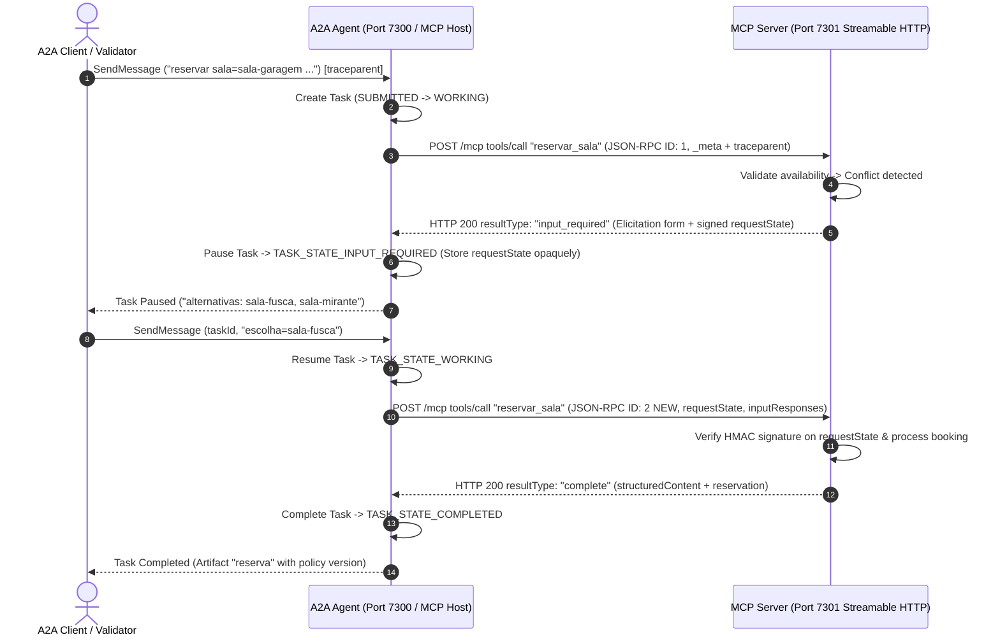
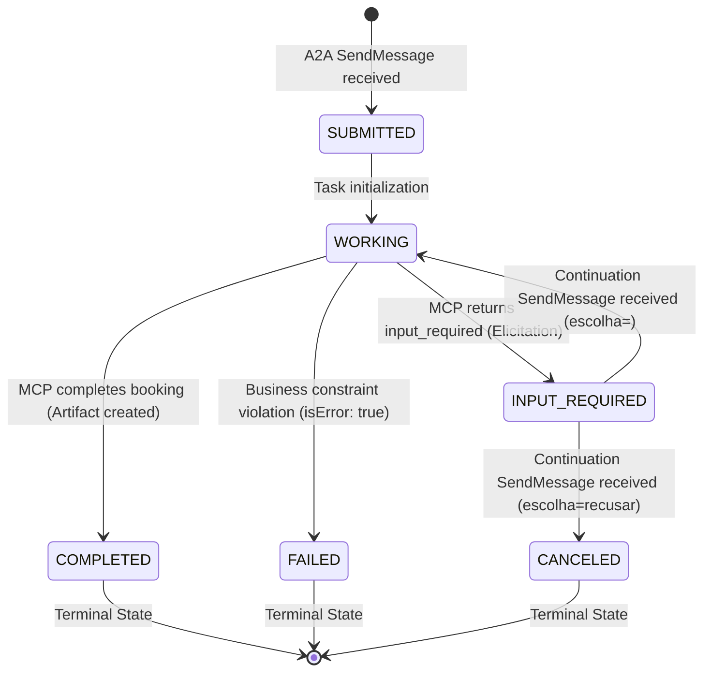

# Technical Specification: A2A Agent with Embedded MCP Host & MRTR Bridge

- **Status**: Approved
- **Version**: 1.0.0
- **Date**: 2026-10-04
- **Related PRD**: [PRD-agente-a2a-mcp-ponte.md](file:///home/almir/projetos/desafio-a2a-com-mcp/docs/prd/PRD-agente-a2a-mcp-ponte.md)
- **Related ADR**: [ADR-001-arquitetura-ponte-a2a-mcp.md](file:///home/almir/projetos/desafio-a2a-com-mcp/docs/ADR-001-arquitetura-ponte-a2a-mcp.md)
- **Authors**: Antigravity / Software Architecture & Engineering Team (Hill Valley Tech)

---

## 1. System Architecture & High-Level Components

The **A2A-MCP Bridge System** integrates two stateless protocol specifications to provide deterministic room reservation capabilities across corporate AI agents:

1. **External Boundary (A2A Protocol v1.0 Server)**: Exposed on port `7300` using JSON-RPC 2.0 binding over HTTP. Handles Agent Card discovery (`/.well-known/agent-card.json`), task creation, state transitions (`SUBMITTED`, `WORKING`, `INPUT_REQUIRED`, `COMPLETED`, `CANCELED`, `FAILED`), and artifact delivery.
2. **Internal Boundary (MCP Protocol v2 Host & Server)**: Exposed on port `7301` (`/mcp`) using Streamable HTTP. Consumes domain tools (`listar_salas`, `consultar_disponibilidade`, `reservar_sala`) and static policy resources (`politica://uso`).
3. **The MRTR Bridge ("A Ponte")**: Orchestrates interactive elicitation during schedule conflicts. Intercepts `input_required` responses from MCP, pauses the A2A `Task` in `TASK_STATE_INPUT_REQUIRED`, retains an opaque HMAC-signed `requestState`, prompts the client for room alternatives, and retries the MCP tool call with a **new JSON-RPC request ID**.



---

## 2. API Specifications & Data Contracts

### 2.1 Endpoint Summary

| Component | Endpoint / Path | Transport / Binding | HTTP Port | Purpose |
| :--- | :--- | :--- | :--- | :--- |
| **A2A Server** | `GET /.well-known/agent-card.json` | HTTP GET | `7300` | Discovery of Agent Identity & Skill (`reservar-sala`) |
| **A2A Server** | `POST /a2a` | JSON-RPC 2.0 over HTTP | `7300` | Workflow execution (`SendMessage`, `GetTask`) |
| **MCP Server** | `POST /mcp` | Streamable HTTP | `7301` | Protocol capabilities (`tools/*`, `resources/*`) |

---

### 2.2 Required Metadata & Context Headers

Every MCP request generated by the A2A Agent MUST include mandatory metadata within `params._meta`:

```json
{
  "_meta": {
    "io.modelcontextprotocol/protocolVersion": "2026-07-28",
    "io.modelcontextprotocol/clientCapabilities": {
      "elicitation": {
        "form": {}
      }
    },
    "traceparent": "00-4bf92f3577b34da6a3ce929d0e0e4736-00f067aa0ba902b7-01"
  }
}
```

#### Protocol Header Mirrors
HTTP headers MUST mirror body properties where required by protocol spec:
- `MCP-Protocol-Version`: `2026-07-28`
- `Mcp-Method`: `tools/call` or `resources/read`
- `Mcp-Name`: Tool or Resource name (e.g., `reservar_sala`, `politica://uso`)
- Mismatched headers MUST be rejected with JSON-RPC error code `-32020`.

---

### 2.3 MCP Tool Contracts

#### 1. `listar_salas`
- **Description**: Returns all registered meeting rooms.
- **Input Parameters**: None (`{}`)
- **Output Schema (`structuredContent`)**:
  ```json
  {
    "type": "array",
    "items": {
      "type": "object",
      "properties": {
        "id": { "type": "string" },
        "nome": { "type": "string" },
        "capacidade": { "type": "integer" },
        "recursos": { "type": "array", "items": { "type": "string" } }
      },
      "required": ["id", "nome", "capacidade", "recursos"]
    }
  }
  ```
- **Text Block**: Must include equivalent JSON-serialized text content for compatibility.

#### 2. `consultar_disponibilidade`
- **Description**: Checks room availability for a specified window without modifying state.
- **Input Parameters**:
  - `sala` (string, required): Room ID (e.g., `"sala-garagem"`).
  - `inicio` (string, required): ISO-8601 start timestamp with timezone `-03:00`.
  - `fim` (string, required): ISO-8601 end timestamp with timezone `-03:00`.
- **Validations & Error Handling**: Evaluates business constraints (room existence, operating hours 08:00-20:00, max 2h duration, valid time interval). Returns `isError: true` on violations.

#### 3. `reservar_sala`
- **Description**: Atomically reserves a room or triggers MRTR elicitation on schedule conflict.
- **Input Parameters**:
  - `sala` (string, required): Room ID.
  - `inicio` (string, required): ISO-8601 start timestamp.
  - `fim` (string, required): ISO-8601 end timestamp.
  - `responsavel` (string, required): Requester name.
- **MRTR Retry Parameters (Params level)**:
  - `inputResponses` (object, optional): Dictionary containing client selection (`action: "accept"` or `"decline"`).
  - `requestState` (string, optional): Opaque signed HMAC token containing serialized original request context.

---

### 2.4 MCP Resource Contract

- **URI**: `politica://uso`
- **MIME Type**: `text/markdown`
- **Content**: Static content loaded from `dados/politica-de-uso.md`. First line contains version metadata: `versao: 2026-11-01`.
- **Unknown URI Handling**: Any `resources/read` for invalid URIs MUST return JSON-RPC error `-32602`. Returning empty content array is strictly forbidden by MCP spec.

---

### 2.5 Wire Payloads & Schema Definitions

#### A. MCP `input_required` Conflict Response (MRTR Elicitation)
```json
{
  "jsonrpc": "2.0",
  "id": 1,
  "result": {
    "resultType": "input_required",
    "inputRequests": {
      "req-key-001": {
        "method": "elicitation/create",
        "params": {
          "mode": "form",
          "message": "A sala pedida esta ocupada nesse intervalo. Escolha uma alternativa.",
          "requestedSchema": {
            "type": "object",
            "properties": {
              "sala": {
                "type": "string",
                "enum": ["sala-fusca", "sala-mirante"]
              }
            },
            "required": ["sala"]
          }
        }
      }
    },
    "requestState": "eyJhbGciOiJIUzI1NiIsInR5cCI6IkpXVCJ9...<hmac_token>"
  }
}
```

#### B. MCP Retry Request (with New JSON-RPC ID)
```json
{
  "jsonrpc": "2.0",
  "id": 2,
  "method": "tools/call",
  "params": {
    "name": "reservar_sala",
    "arguments": {
      "sala": "sala-garagem",
      "inicio": "2026-11-03T14:00:00-03:00",
      "fim": "2026-11-03T15:00:00-03:00",
      "responsavel": "Marty"
    },
    "inputResponses": {
      "req-key-001": {
        "action": "accept",
        "content": {
          "sala": "sala-fusca"
        }
      }
    },
    "requestState": "eyJhbGciOiJIUzI1NiIsInR5cCI6IkpXVCJ9...<hmac_token>",
    "_meta": {
      "io.modelcontextprotocol/protocolVersion": "2026-07-28",
      "io.modelcontextprotocol/clientCapabilities": { "elicitation": { "form": {} } },
      "traceparent": "00-4bf92f3577b34da6a3ce929d0e0e4736-00f067aa0ba902b7-01"
    }
  }
}
```

#### C. Final A2A Task Artifact Payload (`name: "reserva"`)
```json
{
  "name": "reserva",
  "parts": [
    {
      "text": "{\"reserva\":\"res-0003\",\"sala\":\"sala-fusca\",\"inicio\":\"2026-11-03T14:00:00-03:00\",\"fim\":\"2026-11-03T15:00:00-03:00\",\"responsavel\":\"Marty\",\"politica\":\"2026-11-01\"}"
    }
  ]
}
```

---

## 3. State Machine & Task Lifecycle Specifications

### 3.1 Task Lifecycle Transitions



### 3.2 State Transition Rules

1. **New Task Execution**: `SendMessage` without `taskId` instantiates a new `Task` in `TASK_STATE_SUBMITTED`, moving immediately to `TASK_STATE_WORKING`.
2. **Interactive Interruption**: When MCP responds with `resultType: "input_required"`, the Agent transitions Task to `TASK_STATE_INPUT_REQUIRED`.
   - **Pause Message Format**: Must be exactly `alternativas: <id1>, <id2>` (ordered as provided in elicitation enum, separated by comma-space, with no extra prefixes or greetings).
   - **State Token Retention**: The Agent associates the opaque `requestState` with `taskId` in-memory.
3. **Invalid Alternative Input**: If `SendMessage` contains `escolha=<invalid_id>`, the Task remains in `TASK_STATE_INPUT_REQUIRED` and re-emits the exact alternatives string.
4. **Task Resumption**: `SendMessage` with `escolha=<id>` resumes Task to `TASK_STATE_WORKING`, executing MCP `tools/call` with **new JSON-RPC ID** and `inputResponses`.
5. **Decline Action**: `SendMessage` with `escolha=recusar` maps to `action: "decline"` in MCP elicitation. The MCP Server completes without booking (`reservado: false`), and the Agent transitions Task to `TASK_STATE_CANCELED`.
6. **Terminal Enforcement**: Sending `SendMessage` targeting a Task in terminal state (`COMPLETED`, `CANCELED`, `FAILED`) MUST be rejected with a JSON-RPC error.

---

## 4. Error Handling & Mapping Matrix

| Category | Trigger Condition | JSON-RPC Code / Protocol | HTTP Status | Response Body / Message Exact Text |
| :--- | :--- | :--- | :--- | :--- |
| **Tool Execution Error** | Room ID not in `salas.json` | `result.isError: true` | `200 OK` | `Sala inexistente: <id>` |
| **Tool Execution Error** | Booking outside 08:00 - 20:00 | `result.isError: true` | `200 OK` | `Fora da janela de uso: a politica permite reservas entre 08:00 e 20:00` |
| **Tool Execution Error** | Duration exceeds 2 hours | `result.isError: true` | `200 OK` | `Duracao acima do limite: a politica permite no maximo 2 hours` |
| **Tool Execution Error** | Inverted/empty window (end <= start) | `result.isError: true` | `200 OK` | `Intervalo invalido: fim deve ser posterior a inicio` |
| **Tool Execution Error** | Schedule conflict with zero alternatives | `result.isError: true` | `200 OK` | `Sem alternativas disponiveis no intervalo` |
| **Protocol Error (MCP)** | Missing/malformed `_meta` | `-32602` | `400 Bad Request` | `Invalid params` |
| **Protocol Error (MCP)** | Non-existent tool call | `-32602` | `200 OK` / `400` | `Tool not found` (or `isError: true`) |
| **Protocol Error (MCP)** | Missing elicitation form capability | `-32021` | `400 Bad Request` | `data.requiredCapabilities` list |
| **Protocol Error (MCP)** | Tampered or expired `requestState` | `-32602` | `400 Bad Request` | HMAC validation failure |
| **Protocol Error (MCP)** | `resources/read` for non-existent URI | `-32602` | `400 Bad Request` | Resource not found |
| **A2A Terminal Error** | SendMessage on finished Task | JSON-RPC `error` | `200 OK` | Task is in terminal state |

---

## 5. Security & Integrity Specifications

1. **HMAC-SHA256 Token Protection**:
   - `requestState` payload contains serialized original arguments, timestamp, and random nonce.
   - Token integrity signature generated using `HMAC-SHA256` with environment secret `REQUEST_STATE_SECRET` (minimum 32-byte hex entropy).
2. **Expiration Window**: Tokens MUST specify expiration between **5 and 30 minutes**. Expired tokens MUST be rejected with error `-32602`.
3. **Stateless Process Resilience**: The MCP Server stores zero session state in memory. Re-signing and validating `requestState` enables process restarts between initial conflict elicitation and client retry without losing transaction context.
4. **Argument Tamper Guarantee**: On retry, if client arguments in `arguments` diverge from sealed parameters in `requestState`, the MCP Server MUST either reject the request or enforce sealed values over modified client parameters.
5. **Opaceness**: The A2A Agent treats `requestState` as completely opaque bytes/strings, never attempting to parse, log, modify, or expose it in A2A card, task status, or messages.

---

## 6. Observability & Tracing Specifications

1. **Context Propagation (`traceparent`)**:
   - Client passes W3C Trace Context header: `traceparent: 00-<trace_id>-<span_id>-01`.
   - Agent extracts `trace_id` and forwards it inside `_meta.traceparent` across all MCP calls for that `Task`.
2. **Stderr Logging Mandate**:
   - The MCP Server MUST log every incoming request to `stderr`.
   - Log entry line MUST contain at minimum: HTTP method/JSON-RPC method, request ID, and `traceparent` (when present in `_meta`).

---

## 7. Compliance Verification Matrix (36 Checks)

The system implementation MUST satisfy all 36 automated checks in `validador/validar.py`:

| Check ID | Verification Focus | Expected Behavior |
| :--- | :--- | :--- |
| `PASS 01` | MCP `tools/list` | Returns `listar_salas`, `consultar_disponibilidade`, `reservar_sala`. |
| `PASS 02` | MCP Tool Schemas | Each tool exposes valid JSON Schema in `inputSchema`. |
| `PASS 03` | `listar_salas` output | Returns `structuredContent` matching `outputSchema` and identical text block. |
| `PASS 04` | Metadata check | Rejects request missing `_meta.protocolVersion` with `-32602` (HTTP 400). |
| `PASS 05` | Capability check | Rejects request missing `_meta.clientCapabilities` with `-32602` (HTTP 400). |
| `PASS 06` | Unknown tool | Rejects invalid tool call via `-32602` or `isError: true`. |
| `PASS 07` | Resource read | `resources/read` for `politica://uso` returns markdown text with policy version. |
| `PASS 08` | Unknown resource | `resources/read` for unknown URI returns `-32602`. |
| `PASS 09` | Business Error | Non-existent room returns `isError: true` and `Sala inexistente: <id>`. |
| `PASS 10` | Business Error | Out-of-hours booking returns `isError: true` and exact window message. |
| `PASS 11` | Business Error | Duration > 2h returns `isError: true` and exact duration message. |
| `PASS 12` | Business Error | Inverted interval returns `isError: true` and exact interval message. |
| `PASS 13` | MRTR Elicitation | Schedule conflict returns `resultType: "input_required"` with `requestState`. |
| `PASS 14` | Elicitation Schema | Form mode elicitation provides alternative rooms in sorted order. |
| `PASS 15` | Missing Capability | Conflict request from client without form elicitation capability returns `-32021` (HTTP 400). |
| `PASS 16` | MRTR Retry | Retry with valid `inputResponses` and `requestState` completes booking. |
| `PASS 17` | Security Check | Tampered `requestState` is rejected with `-32602`. |
| `PASS 18` | Integrity Check | Modified parameters on retry are ignored/rejected in favor of sealed state. |
| `PASS 19` | Decline Action | Elicitation `decline` completes with `reservado: false` without `isError`. |
| `PASS 20` | Conflict Error | Conflict with zero available alternatives returns `isError: true` and exact message. |
| `PASS 21` | Agent Card | `GET /.well-known/agent-card.json` returns HTTP 200 with valid JSON. |
| `PASS 22` | Agent Card Spec | Card declares JSON-RPC interface with URL and protocol version `1.0`. |
| `PASS 23` | Agent Card Skill | Card declares skill `id: "reservar-sala"`. |
| `PASS 24` | Direct Booking | `SendMessage` for available room completes Task (`TASK_STATE_COMPLETED`). |
| `PASS 25` | Task Artifact | Completed Task produces `reserva` artifact containing policy version. |
| `PASS 26` | Task Inspection | `GetTask` returns `id`, `contextId`, current status, and artifact. |
| `PASS 27` | Task Pausing | `SendMessage` for occupied room pauses Task in `TASK_STATE_INPUT_REQUIRED`. |
| `PASS 28` | Pause Message | Paused Task lists alternatives in exact format `alternativas: <id1>, <id2>`. |
| `PASS 29` | Invalid Selection | Choice outside enum keeps Task in `TASK_STATE_INPUT_REQUIRED`. |
| `PASS 30` | Task Resumption | Choice continuation completes Task with chosen room reservation. |
| `PASS 31` | Terminal State | `SendMessage` targeting completed/canceled/failed Task is rejected with error. |
| `PASS 32` | Decline Flow | Choice `escolha=recusar` transitions Task to `TASK_STATE_CANCELED`. |
| `PASS 33` | Task Isolation | Concurrent paused Tasks execute independently without mixing `requestState`. |
| `PASS 34` | Token Opacity | `requestState` is never exposed in any A2A response or card. |
| `PASS 35` | Tool Failure Mapping | Tool execution error (e.g. invalid room) sets Task to `TASK_STATE_FAILED` with tool message. |
| `PASS 36` | Determinism | Repeated identical request produces identical deterministic pause response. |
